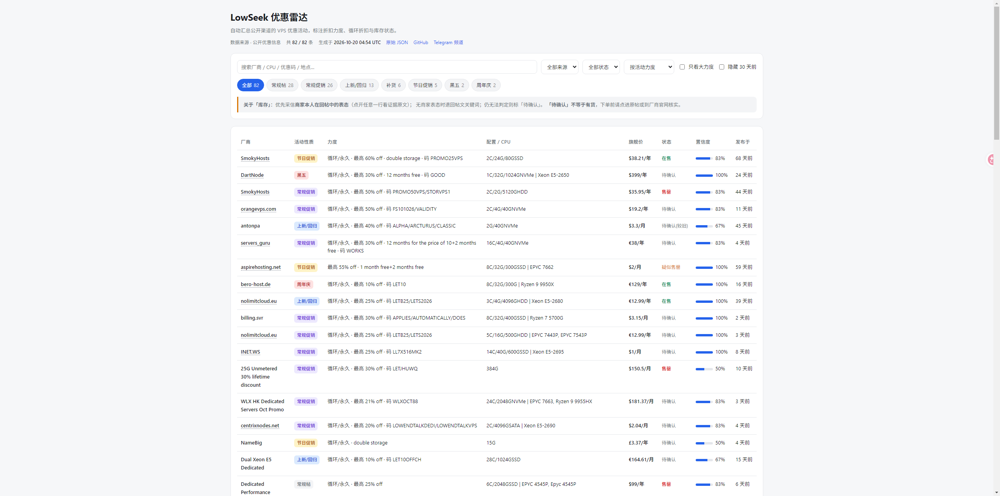

<div align="center">

# letdeals — VPS 优惠聚合雷达

自动抓取 **LowEndTalk Offers** 与 **LowEndBox** 的 VPS 优惠，抽取规格、价格、
折扣力度与**库存状态**，生成可部署的静态站。

**零运行时依赖**（仅 Python 标准库）· 产物是纯静态文件

[](https://vps.lowseek.ai)
[](https://lowseek.ai/)
[](https://t.me/LowSeekChat)
[](LICENSE)

</div>

---

## 📍 相关地址

| 用途 | 地址 |
|---|---|
| **在线站点** | https://vps.lowseek.ai |
| **论坛** | https://lowseek.ai/ |
| **TG 群** | https://t.me/LowSeekChat |
| **TG 频道** | https://t.me/LowSeekNews |

---

## 📸 界面预览



> 一张表看完：厂商、活动性质、折扣力度、配置、旗舰价、**库存状态**、
> 置信度、发布时间。展开任意一行可看到完整规格、优惠码、机房位置，
> 以及**库存判断所依据的回帖原文**。


> 上图由 `tools/render_preview.py` 离线渲染，用于在没有浏览器的环境里检查数据。

> 本项目在 [LINUX DO](https://linux.do) 社区交流与推广，
> 感谢社区佬友的反馈与建议。

---

## 快速开始

```bash
python -m letdeals                 # 抓取两个数据源并生成站点
python -m letdeals --with-replies  # 同时抓回帖（库存判定准确率高得多）
python -m pytest tests -q          # 跑测试

# 打开 site/index.html 即可预览（数据内嵌，无需服务器）
```

常用参数：

```bash
python -m letdeals --sources let            # 只用 LowEndTalk
python -m letdeals --recent-days 30         # 只保留最近 30 天
python -m letdeals --offline-let data/feed_let.xml   # 离线重跑
python -m letdeals --no-site                # 只产 JSON / Markdown
python -m letdeals --reply-limit 20         # 只对前 20 帖抓回帖
```

---

## 项目结构

```
letdeals/            主包
  config.py          配置（支持环境变量，可配自有域名）
  http.py            带重试与退避的抓取
  textutil.py        HTML 清洗 / 单位换算 / 拍平表格重建
  extract.py         字段抽取 + 库存判定
  replies.py         回帖抓取 + 商家表态识别
  sources.py         数据源（LET / LEB）
  pipeline.py        编排 + 跨源去重
  forum.py           搬运到自己的 Flarum 论坛（旁路功能）
  render.py          Markdown + 静态站生成
  cli.py             命令行入口
tests/               201 个 pytest 用例
deploy/              部署脚本与指南
tools/               分析/回归/预览辅助脚本
legacy/              重构前的独立脚本（仅用于回归比对）
```

---

## 为什么需要「回帖」这一层

帖子正文通常**不写库存**，商家只在**回帖里**事后说「售罄了 / 补货了」。
RSS 只给首帖正文、不含回帖 —— 这是只靠帖文时库存判定率仅 25% 的根因。

接了回帖层后：

| 指标 | 仅帖文 | 含回帖 |
|---|---|---|
| 库存已判定 | 25% | **31%** |
| 其中来自商家表态 | 0% | **17%** |

### 三个关键设计

**1. 末页优先抓取**

实测商家表态出现在回帖流的 **75%–100%** 位置（他们只在被问到时才回）：

| 帖子 | 回帖数 | 商家表态位置 |
|---|---|---|
| #218392 | 60 | 75% |
| #220060 | 34 | 76% |
| #221713 | 90 | 92% |
| #216281 | 42 | 100% |

因此默认 `--reply-strategy latest`：**从最后一页往前抓**。
只抓 1 页就拿到最新状态，且请求量最小。

若按传统「从第 1 页顺序抓」，BERO 那条会得到一个月前的旧状态
（`RESTOCKING`），而正确答案是 `ENDED`（"The sale is over"）。

**2. 商家身份识别**

LET 用 CSS class 标记回帖身份，商家本人带：

```
Item ItemComment isOriginalPoster Role_PatronProvider
```

判定优先级：**商家表态 > 帖文关键词 > 用户提及（弱证据）**。
用户说「sold out」可能只是猜测，只标为 `LIKELY_SOLD_OUT`。

**3. 语境校验（四类误判防线）**

| 陷阱 | 例子 | 处理 |
|---|---|---|
| 疑问句 | `BF L Flash sold out ?` 是用户在问 | 句首疑问词或句尾问号则丢弃 |
| 否定句 | `out of stock … it's not like that` 商家在**否认** | 检测否定短语，丢弃 |
| 非库存对象 | `Free trial is now available` | 要求邻近有 stock/units 等对象 |
| 促销资格 | `promotion … available only for monthly billing` | 识别适用范围表述 |

还有一个**语义反向**陷阱：`working on a restock` 直觉像"在售"，
实际含义是**现在没货、正在补**。正则顺序必须让 `RESTOCKING`
排在 `ON_SALE` 判定之前，否则整个语义会反。

---

## 库存状态说明

| 状态 | 含义 | 证据强度 |
|---|---|---|
| `ON_SALE` | 商家确认在售 | 强 |
| `SOLD_OUT` | 商家确认售罄 | 强 |
| `RESTOCKING` | 商家正在补货（= 当前缺货） | 强 |
| `PARTIAL` | 部分套餐售罄、部分仍有货 | 强 |
| `ENDED` | 活动已结束 | 强 |
| `LIKELY_SOLD_OUT` | 用户提及售罄 | **弱** |
| `UNVERIFIED` / `UNVERIFIED_STALE` | 无法判定 | — |

> **「待确认」不等于有货。** 站点会在展开行里给出判定所用的**证据原文**
> （含作者与日期），可自行核对。

### `PARTIAL` 为什么重要

商家常说「Budget 仍有货、Premium 已售罄」——两个状态同时为真。
判成完全售罄或完全在售都是误导，因此单列 `PARTIAL`。

---

## 数据源与过滤

### LowEndTalk Offers

Vanilla 论坛 RSS，含完整正文。`<guid>` 形如 `221713@/discussions`，可提取 thread_id。

### LowEndBox

WordPress 博客 RSS，正文在 `content:encoded`。**无讨论串，因此不抓回帖。**

LEB 是编辑博客，会混入大量非优惠内容（如「微软砍存储」「我的书被训练 AI」）。
按 `<category>` + **正文规格密度**双重判定过滤：

- `Giveaways` / `Tutorials` 等**硬排除**
- `Editorial & News` 为**软排除** —— 但正文若含 ≥2 处规格描述（`32 GB RAM`、
  `8 vCPU` 等）则保留，因为 LEB 有时把真优惠也归到这类

实测真优惠的规格描述普遍 ≥4 处，新闻类多为 0 处。

### 跨源去重

同一优惠可能两边都发，用「厂商 + 价格 + 旗舰配置」指纹识别，保留信息更全的一条。

**数据不足时拒绝去重**：无价格且无规格的记录指纹为 `None`，不参与合并 ——
否则像 `raindog308|-|-----` 这种空指纹会把任意两条新闻误判成重复。

---

## 部署

完整指南见 **[deploy/DEPLOY.md](deploy/DEPLOY.md)**。

两种方案：

| 方案 | 抓取方 | 网站 |
|---|---|---|
| **A（推荐）** | GitHub Actions（云 IP，不被封） | 你的服务器 + 你的域名 |
| B | 你的服务器（固定 IP） | 你的服务器 |

> **为什么推荐 A**：论坛前面板有 Cloudflare，云主机固定 IP 被拦概率较高
> （开发中已实测遇到 403）。Actions 每次运行都是不同云 IP，天然规避；
> 站点照样发到你的域名。<br>
> 方案 B 部署前请**先手动跑一次**确认 IP 能抓到数据。

### 绑定自有域名

改环境变量即可，**无需改代码**：

```bash
LDR_SITE_TITLE=VPS 活动雷达
LDR_SITE_URL=https://deals.example.com   # 设置后生成 canonical + 绝对 sitemap
LDR_SITE_DESC=...
LDR_SITE_FOOTER=...
```

设置 `LDR_SITE_URL` 后会自动生成 canonical 链接、绝对 sitemap URL，
并在 `robots.txt` 加 Sitemap 行；未设置则用相对路径。

### 论坛搬运（可选）

还能把优惠帖**自动搬运到自己的 Flarum 论坛**，方便中文用户阅读。
站点上每行的「查看原帖」会变成「中文详情 →」+「原帖 →」（有对应帖时）。

**默认关闭且默认演练**，需显式开启：

```bash
LDR_FORUM_ENABLED=true LDR_FORUM_DRY_RUN=false \
LDR_FORUM_API_KEY=xxx python -m letdeals --post-forum
```

| 安全机制 | 说明 |
|---|---|
| 默认关闭 | 不改配置就不会发任何内容 |
| 默认演练 | 只打印将要发布的内容 |
| 幂等 | 同一活动永不重复发布 |
| 限流 | 每次最多 N 条，只发最近 N 天 |

完整说明见 **[deploy/FORUM.md](deploy/FORUM.md)**。

### 安全网

两个方案都有 **「记录数为 0 则拒绝发布」** 的保护 ——
抓取失败时保留上次数据，避免把线上站点刷成空白。

---

## 开发

```bash
python -m pytest tests -q                    # 120 个用例
python tools/regress.py                      # 重构回归比对（19 字段零差异）
python tools/render_preview.py               # 生成 preview.png
python tools/analyze_leb.py                  # 分析 LEB 真优惠 vs 新闻特征
```

### 测试覆盖

| 文件 | 覆盖内容 |
|---|---|
| `test_textutil.py` | HTML 清洗、嵌套引用剥离、单位换算、**拍平表格重建** |
| `test_extract.py` | 规格/价格/折扣/活动性质/厂商名/库存判定 |
| `test_replies.py` | 回帖解析、商家识别、四类误判防线、语义反向 |
| `test_sources.py` | 两个源的解析、LEB 分类过滤、跨源去重 |
| `test_render.py` | 评分、格式化、站点产物、域名配置、XSS 转义 |
| `test_http.py` | 重试、退避、永久失败判定 |

**黄金样本**：BERO HOST 十周年帖（`#221713`）—— 表格重建须完整还原其
15 个套餐，其中 Anniversary XXL = `8C/32G/300G/25TB/€129`。

### 重构说明

本项目由原型重构而来，`legacy/` 保留重构前的独立脚本以便比对。
`tools/regress.py` 验证了重构后 **19 个共有字段、100 条记录逐字段零差异**。

---

## 局限（诚实说明）

- **库存覆盖仍有限**：约 69% 记录为「待确认」。商家不主动汇报库存，
  回帖表态有滞后性 —— 这是真实的能力边界。
- **未做下单页探测**：可补足回帖滞后性，但每家厂商写法不同，
  且 JS 渲染（HostBrr）或需登录（NolimitHost）的站点无法自动探测。
- **优惠码需复核**：已过滤 `CODE`/`DISCOUNT` 等占位词，但仍可能有漏网。
- **CPU 型号覆盖 42%**：多数帖子不写型号，正则无法凭空推断。
- **正则面向英文帖**：中文帖（少量）未优化。
- **活动性质为关键词分类**：会有误判（如把普通 sale 归入节日促销）。
